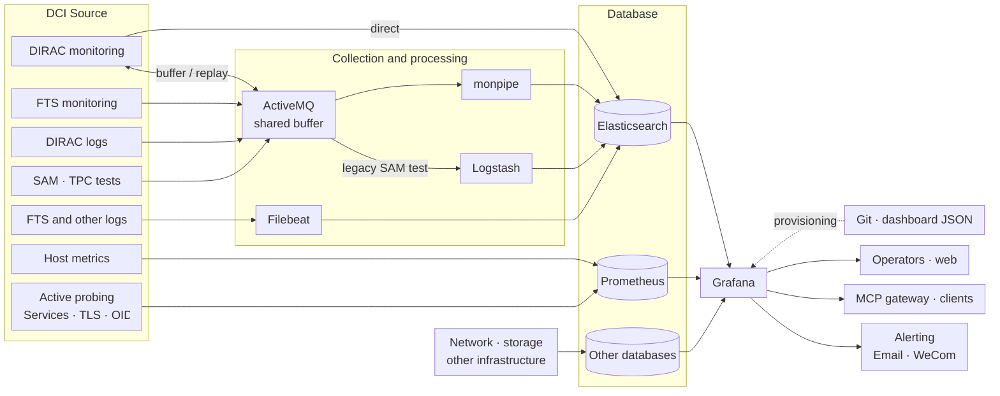
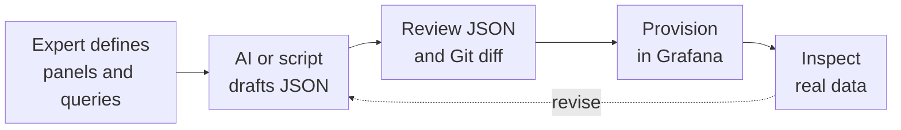
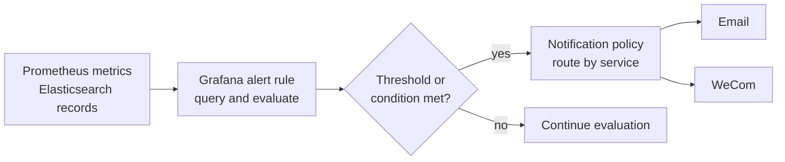
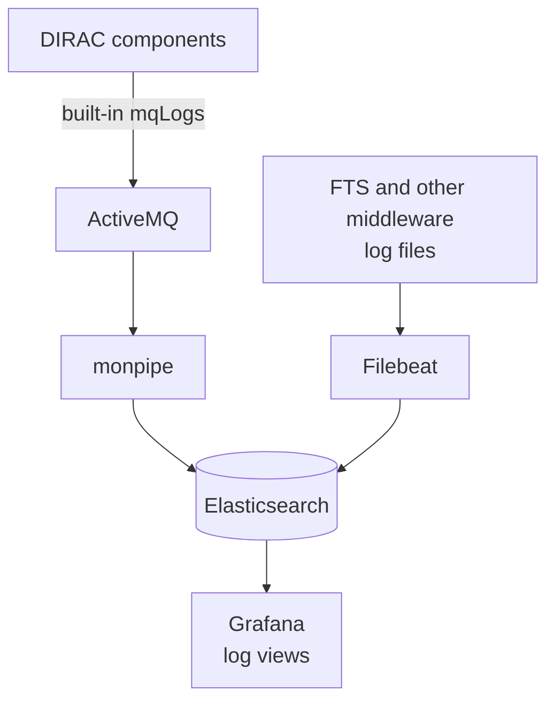

<a href="http://cepc.ihep.ac.cn/" class="cover-brand cover-cepc-logo" target="_blank" rel="noopener noreferrer" aria-label="CEPC website"></a>
<a href="https://english.ihep.cas.cn/" class="cover-brand cover-ihep-logo" target="_blank" rel="noopener noreferrer" aria-label="Institute of High Energy Physics website"></a>

# Monitoring for the<br/>Distributed Computing Infrastructure

#### Monitoring of sites, services, and middleware

<br>

**Xiao Han** on behalf of the IHEP DCI Group · <a href="mailto:hanx@ihep.ac.cn">hanx@ihep.ac.cn</a>

<br>

<a href="https://indico.ihep.ac.cn/event/28911/" class="text-sm">The 2026 International Workshop on the High Energy Circular Electron Positron Collider</a>

<br>

**24 October 2026** · *Shanghai, China*

<a href="https://dci-grafana.ihep.ac.cn/"><mdi-view-dashboard-outline /> DCI Grafana</a>
 · <a href="https://github.com/hanx-hep/28th-junocm-dci"><mdi-history /> JUNO case study</a>


<!--
Timing: 0:30

Good afternoon. I am Xiao Han, speaking on behalf of the IHEP DCI Group. This report describes the IHEP monitoring system used for JUNO, HERD, and shared distributed-computing infrastructure, and discusses which parts may be applicable to future CEPC computing. I will cover Grafana access and dashboards, active service probes, centralized middleware logs, host metrics, and how dci-agent helps operators inspect this evidence.
-->
---
layout: default
---

# Motivation and current use

<div class="cols mt-8">
  <div class="scope-panel">
    <h2>Why monitoring matters</h2>
    <p>Modern large-scale high-energy physics experiments rely on distributed computing for data transfer, storage, and processing across sites.</p>
    <p> will also require DCI. Monitoring is needed to assess the availability and performance of computing sites, services, and data-transfer paths.</p>
  </div>
  <div class="scope-panel">
    <h2>IHEP DCI monitoring today</h2>
    <p>The IHEP DCI monitoring system already supports <strong>JUNO</strong> and <strong>HERD</strong>.</p>
    <p>It also covers shared distributed-computing infrastructure, including hosts, middleware services, and service probes.</p>
    <div class="experiment-logos">
      <a href="https://juno.ihep.cas.cn/" target="_blank" rel="noopener noreferrer" aria-label="JUNO experiment website">
        
      </a>
      <a href="https://herd.ihep.ac.cn/" target="_blank" rel="noopener noreferrer" aria-label="HERD experiment website">
        
      </a>
    </div>
    <div class="logo-credit">Images: <a href="https://english.ihep.cas.cn/nw/han/y15/201501/t20150123_296525.html" target="_blank" rel="noopener noreferrer">JUNO Collaboration</a> · <a href="https://herd-iam.ihep.ac.cn/resources/images/logos/herd-logo.png" target="_blank" rel="noopener noreferrer">HERD IAM</a></div>
  </div>
</div>


<!--
Timing: 0:55

Distributed computing infrastructure is part of how modern large-scale high-energy physics experiments move, store, and process data at multiple sites. CEPC will need this infrastructure, so monitoring the state of its sites, services, and data-transfer paths will matter. At IHEP, the current monitoring system supports JUNO and HERD and also covers shared computing infrastructure. The following technical examples come largely from the existing deployment; CEPC-specific sites, tests, access rules, and alert thresholds still need to be specified.
-->
---
layout: default
---

# Monitoring architecture



<div class="architecture-note mt-2">
The existing IHEP DCI monitoring system supports JUNO and HERD and also monitors shared distributed-computing infrastructure.
</div>

<div class="text-center muted text-xs mt-2">Shared ActiveMQ and Elasticsearch · monpipe: a DCI Group monitoring-data transport service.</div>


<!--
Timing: 1:05

There are two different kinds of middleware output, but one shared ActiveMQ and one shared Elasticsearch. DIRAC monitoring writes directly to Elasticsearch. If that path stalls, DIRAC temporarily stores data in ActiveMQ. After recovery, DIRAC monitoring itself reads those buffered data and writes them along the original DIRAC-to-Elasticsearch path. Current MQ processing uses monpipe for FTS monitoring, DIRAC logs, and SAM/TPC results; only legacy SAM tests retain the Logstash path. Monpipe is a DCI Group service for transporting monitoring data. FTS and other middleware logs use Filebeat. Active service, TLS, and OIDC checks use Prometheus, as do host metrics. Grafana also queries databases for network, storage, and other infrastructure; there is no separate probe-result database. The Git node on the right denotes configuration provenance, not a monitoring-data output. The system supports JUNO, HERD, and shared IHEP DCI infrastructure.
-->
---
layout: section
---

# 1 · Grafana dashboards


<!--
Timing: 0:10

First I will describe the Grafana system, how dashboard definitions are managed, and how alerting works.
-->
---
layout: default
---

# Grafana monitoring system

<div class="grafana-intro mt-3">
  <div class="grafana-features">
    <div class="feature-item">
      <strong>Multiple organizations</strong>
      <ul>
        <li>JUNO monitoring</li>
        <li>HERD monitoring</li>
        <li>Grid middleware, including CA services</li>
      </ul>
    </div>
    <div class="feature-item"><strong>IHEP account login</strong><span>Users access Grafana with their IHEP identity.</span></div>
    <div class="feature-item"><strong>Access control</strong><span>Organization and dashboard permissions limit who can view or edit.</span></div>
    <div class="feature-item"><strong>Alerts</strong><span>Rules on monitored data can notify operators by email and WeCom.</span></div>
  </div>
  <div class="grafana-demo">
    <video :src="'./grafana-demo-trimmed.mp4'" autoplay loop muted playsinline controls preload="metadata" aria-label="Grafana interface screen recording"></video>
  </div>
</div>


<!--
Timing: 1:00

Grafana is the common web interface for IHEP DCI monitoring. We use multiple organizations for JUNO, HERD, and grid middleware such as CA services. IHEP account login and permissions control access to dashboards and configuration. Grafana also evaluates alert rules and sends notifications through email and WeCom. The recording on the right shows the interface at 1.5 times the original speed, without audio. It has been trimmed by five seconds at the start and ten seconds at the readable end.
-->
---
layout: default
---

# Dashboard JSON workflow



<div class="json-details mt-6">
  <div><strong>31 JSON files in Git</strong><br/>Admin 10 · DIRAC 9 · TPC 6 · User 4 · Shift 2</div>
  <div><strong>30-second file check</strong><br/>Grafana loads the files; unexported UI edits to provisioned dashboards can be overwritten.</div>
  <div><strong>Human validation</strong><br/>AI helps with repeated panels. Experts check queries, units, thresholds, and results.</div>
</div>

<div class="takeaway compact mt-5">The <strong>SAM v4</strong> and <strong>TPC transfer matrix</strong> views illustrate assisted development. File provisioning covers the repository’s dashboards, not every dashboard in the instance.</div>


<!--
Timing: 1:25

Dashboard definitions can be exported from the Grafana UI or drafted as JSON with scripts and AI assistance. Experts check queries, units, thresholds, and panels against actual data before committing. The repository currently has thirty-one JSON files in five folders; Grafana checks provisioned files every thirty seconds. UI edits must be exported and committed to persist for a provisioned dashboard. SAM v4 and the TPC transfer matrix are examples of assisted development. This inventory does not include dashboards stored only in the instance database.
-->
---
layout: default
---

# Grafana alerting



<div class="two-notes compact-notes mt-3">
  <div><strong>Rule</strong><br/>Select a monitored quantity, evaluation interval, and condition relevant to the service.</div>
  <div><strong>Response</strong><br/>Route the notification to its operators; the alert is a signal for investigation, not a diagnosis.</div>
</div>

<div class="takeaway compact mt-3">Existing delivery channels: <strong>email and WeCom</strong>. -specific thresholds, recipients, and response procedures still need to be defined.</div>

<!--
Timing: 0:55

Grafana evaluates a query against a rule at regular intervals. When the specified condition holds, the notification policy routes the alert to the responsible operators, here by email or WeCom. The diagram shows the general mechanism rather than a particular production rule. For a new experiment, the monitored quantities, thresholds, recipients, and operational response must be agreed and tested separately.
-->
---
layout: section
---

# 2 · Active probing


<!--
Timing: 0:10

Active probes test services from the outside. The next two slides cover the range of checks and the SAM site-to-site matrix.
-->
---
layout: default
---

# Service checks and metrics

<div class="probe-grid expanded-probes mt-3">
  <div><strong>SAM site tests</strong><span>Service and storage checks between grid sites; retain source and destination.</span></div>
  <div><strong>TPC tests</strong><span>Third-party copy checks exercise transfer paths between storage endpoints.</span></div>
  <div><strong>DCI services</strong><span>Active checks test whether distributed-computing services respond as expected.</span></div>
  <div><strong>TLS certificates</strong><span>Check validity and remaining lifetime before expiry affects a service.</span></div>
  <div><strong>OIDC checks</strong><span>Test the identity-service endpoints needed for authentication.</span></div>
  <div><strong>Database metrics</strong><span>Track database activity and health alongside external service checks.</span></div>
</div>

<div class="takeaway compact mt-3">Active probes test service behavior <strong>from a client’s point of view</strong>; database and host metrics provide complementary internal measurements.</div>

<!--
Timing: 0:55

Active probing is broader than SAM. We run checks for DCI services and inter-site transfers, including TPC. Certificate checks cover TLS expiry, and OIDC checks cover identity endpoints. Database metrics complement these external checks with measurements of database activity and health; they are not themselves all active probes. A healthy host or database does not necessarily mean a remote client can authenticate, reach a service, or transfer data. The next slide shows SAM results alongside TPC site-pair matrices.
-->
---
layout: default
---

# SAM and TPC tests

<div class="probe-screenshots mt-3">
  <div>
    <h2>SAM test</h2>
    <a href="./images/SAMtest.png" target="_blank" rel="noopener noreferrer"></a>
    <div class="snapshot-explanation mt-3">Availability and history summarize service checks; individual records retain the <strong>source and destination</strong> for follow-up.</div>
    <div class="takeaway compact mt-3">A single site-availability value is not enough: routes and configurations can produce <strong>site-pair or direction-dependent failures</strong>.</div>
    <a class="snapshot-link" href="https://dci-grafana.ihep.ac.cn/d/samtestv3/sam-test-v4?orgId=1" target="_blank" rel="noopener noreferrer"><mdi-open-in-new /> Open SAM dashboard · sign in if needed</a>
  </div>
  <div>
    <h2>TPC test</h2>
    <a href="./images/TPC-matrix.png" target="_blank" rel="noopener noreferrer"></a>
    <div class="snapshot-explanation mt-2">Pull and push can differ for the same <strong>source × destination</strong> pair.</div>
    <a class="snapshot-link" href="https://dci-grafana.ihep.ac.cn/d/tpc-transfer-monitoring?orgId=1" target="_blank" rel="noopener noreferrer"><mdi-open-in-new /> Open TPC dashboard · sign in if needed</a>
  </div>
</div>

<div class="snapshot-footnote">Provided screenshots · historical examples, not current availability · click either image for full resolution.</div>


<!--
Timing: 1:15

The supplied screenshots show two complementary active tests. The SAM view on the left contains availability, state history, and records that identify source and destination sites. It is not itself a matrix panel. The TPC screenshot on the right explicitly shows source-destination matrices for pull and push, with different patterns of failures. Distributed storage cannot be described adequately by a single availability number per site: routes, direction, and endpoint configuration matter. These are historical examples, not current measurements, and no common time window is implied between the images. Click an image for full resolution or open its Grafana dashboard after signing in.
-->
---
layout: section
---

# 3 · Middleware logs


<!--
Timing: 0:10

This section describes centralized log storage for grid middleware, with DIRAC and Filebeat as two ingestion methods.
-->
---
layout: default
---

# Centralized middleware logs

<div class="cols mt-2">
  <div>

## Collection methods

<div class="triage-list mt-4">
  <div><small>DIRAC</small><strong>Built-in mqLogs backend</strong><span>DIRAC services and agents send logs through ActiveMQ and monpipe into Elasticsearch.</span></div>
  <div><small>FTS AND OTHER MIDDLEWARE</small><strong>Filebeat collection</strong><span>Filebeat reads local service log files and forwards them to Elasticsearch for central indexing.</span></div>
</div>

<div class="takeaway compact mt-3">Common fields such as time, component, and severity support cross-service searches.</div>

  </div>
  <div>

## Storage and inspection



  </div>
</div>


<!--
Timing: 1:00

This slide concerns service logs, not the monitoring-data outputs shown separately in the architecture. DIRAC's built-in mqLogs backend sends records to ActiveMQ, which buffers them before monpipe processes them into Elasticsearch. Current MQ processing uses monpipe; Logstash is retained only for legacy SAM tests. FTS and other middleware logs use Filebeat to collect local log files for Elasticsearch, while DIRAC monitoring data can go directly to Elasticsearch with its separate recovery buffer. Grafana provides the log-inspection interface. Field mappings and delivery should be validated per component and again when a middleware version changes.
-->
---
layout: default
---

# Inspecting component logs

<a href="./images/logs.png" target="_blank" rel="noopener noreferrer"></a>

<div class="json-details mt-5">
  <div><strong>Select severity</strong><br/>This example selects ERROR messages across all component categories and names.</div>
  <div><strong>Compare components</strong><br/>The curves show different components; peaks identify time windows for investigation.</div>
  <div><strong>Inspect records</strong><br/>Use the full dashboard to narrow the component and time range, then read individual messages.</div>
</div>

<div class="snapshot-footer mt-4">
  <span>Provided screenshot · historical example · click image for full resolution.</span>
  <a href="https://dci-grafana.ihep.ac.cn/d/bfgu666p30xdsb/component-logs?orgId=1" target="_blank" rel="noopener noreferrer"><mdi-open-in-new /> Open full dashboard · sign in if needed</a>
</div>


<!--
Timing: 1:10

This supplied screenshot is a historical example from the centralized DIRAC logs dashboard. The panel is filtered to ERROR across all categories and names. The legend identifies FileCatalog, ComponentMonitoring, and StorageElementProxy, while the peaks help select a period to inspect. Counts are not a diagnosis or a normalized error rate. The full dashboard provides the context for filtering and reading individual messages. The next slide lists proposed improvements; the screenshot does not imply that automated log alerts or diagnosis are already implemented.
-->
---
layout: default
---

# Planned log-monitoring work

<div class="two-notes mt-4">
  <div><strong>Available</strong><br/>Central collection and a dashboard for filtering and inspecting component records.</div>
  <div><strong>Not yet evaluated</strong><br/>Alert criteria, log retention periods, and links from service metrics to log records.</div>
</div>

<div class="status-stack next cols-2 mt-3">
  <div><mdi-arrow-right-circle-outline /><span><strong>Repeated error messages</strong><br/>Evaluate grouping by component and message type.</span></div>
  <div><mdi-arrow-right-circle-outline /><span><strong>Rate-based alerts</strong><br/>Establish baselines before setting component-specific thresholds.</span></div>
  <div><mdi-arrow-right-circle-outline /><span><strong>Retention policy</strong><br/>Define storage periods and index lifecycle requirements.</span></div>
  <div><mdi-arrow-right-circle-outline /><span><strong>Metrics and logs</strong><br/>Preserve component and time selections when moving between views.</span></div>
</div>

<div class="takeaway mt-4">Check log delivery and field mappings when changing <strong>middleware versions</strong> or collection methods.</div>


<!--
Timing: 1:10

The current pipeline collects and stores logs and supports manual searches. Further work is needed before it can reliably drive alerts. We need to examine repeated messages, define baselines and thresholds by component, agree on retention periods, and preserve context when switching from a metric to log records. When middleware is upgraded or reconfigured, the chosen collector and parsed fields should be tested again. These are proposed tasks, not delivered functions.
-->
---
layout: section
---

# 4 · Hosts and services


<!--
Timing: 0:10

The last monitoring source is machine-level measurements and service checks; then I will briefly show how dci-agent uses the evidence.
-->
---
layout: default
---

# Host and service monitoring

<div class="cols mt-10">
  <div>

## Prometheus targets

```bash
# on the monitoring server
prometheus-cmd.py add  <hostname> 9100
prometheus-cmd.py list
prometheus-cmd.py remove <hostname>
```

<div class="takeaway compact mt-5">
The target-management command updates the Prometheus configuration on the monitoring server.
</div>

  </div>
  <div>

## Reference deployment

<div class="provider-grid two-wide mt-4">
  <div class="provider"><strong>26</strong><span>hosts*</span></div>
  <div class="provider"><strong>10</strong><span>jobs*</span></div>
</div>

<div class="filter-strip mt-4">
  <span>machinery</span><span>activemq</span><span>mysql</span><span>eos</span><span>oidc</span><span>tls</span>
</div>

<div class="takeaway compact mt-5">
Host metrics include CPU, memory, disk, and network use. Other jobs check services and certificate expiry. <small>*Monitoring snapshot, September 2026.</small>
</div>

  </div>
</div>


<!--
Timing: 1:00

The host metrics are collected by Prometheus from node exporters. The twenty-six hosts and ten job names shown here are a snapshot from September 2026, not a measurement of the current fleet. Jobs include machine metrics and checks for services such as ActiveMQ, MySQL, storage, authentication, and certificate expiry. The command-line tool on the monitoring server manages targets; it is not intended to run from this slide repository. CEPC would require its own target inventory and service coverage.
-->
---
layout: section
---

# 5 · Dr. DCI

<!--
Timing: 0:10

Part five is Dr. DCI: how dci-agent uses monitoring evidence to assist operators with cross-system checks and diagnosis.
-->
---
layout: default
---

# Dr. DCI architecture

<div class="dr-dci-layout mt-4">
  <div class="dr-levels">
    <div><strong>L1 · Analyzes</strong><span>Read-only checks and diagnosis; humans decide.</span></div>
    <div><strong>L2 · Assists</strong><span>Routine, reversible operational actions.</span></div>
    <div><strong>L3 · Approved</strong><span>Critical actions only with administrator consent.</span></div>
    <div><strong>L4 · Autonomous</strong><span>Full automation: a future goal, not current capability.</span></div>
    <small>Autonomy stages, by analogy with automated driving.</small>
  </div>
  <div class="dr-architecture">
    <div class="dr-source"><strong>READ-ONLY NFS</strong><span>configs · logs · source code · credentials sanitized</span></div>
    <div class="dr-systems"><span>DIRAC</span><span>IHEPDIRAC</span><span>FTS3</span><span>grid-data</span><span>ihep-T1-ce</span></div>
    <div class="dr-down"><span>read-only evidence</span><i aria-hidden="true"></i></div>
    <div class="dr-flow">
      <div class="dr-node"><small>MCP</small><strong>IHEP MCP</strong><span>monitoring · server control</span></div>
      <b aria-hidden="true">→</b>
      <div class="dr-node dr-agent"><small>HERMES-BASED</small><strong>dci-agent</strong><span>correlate · analyze · report</span></div>
      <b aria-hidden="true">→</b>
      <div class="dr-node"><small>OUTPUT</small><strong>Status reports</strong><span>checks &amp; findings</span></div>
    </div>
    <div class="dr-triggers">
      <div class="dr-chat"><i aria-hidden="true"></i><strong>Feishu · Mattermost · WeCom · WebUI</strong><span>administrator chat</span></div>
      <div class="dr-schedule"><strong>cronjob</strong> → scheduled checks</div>
    </div>
  </div>
</div>

<div class="takeaway compact mt-3"><strong>Read-only evidence</strong>; operational writes use separate, scoped MCP functions.</div>

<!--
Timing: 1:15

The left column adapts the four stages in the DIRACx report as L1 to L4, by analogy with automated driving: read-only analysis, routine reversible assistance, critical actions with administrator approval, and full automation as a future goal. These are our descriptive stages, not a formal certification. The right-hand architecture follows slide 6 of that report. Sanitized read-only NFS evidence from DIRAC, IHEPDIRAC, FTS3, grid-data, and ihep-T1-ce feeds the Hermes-based dci-agent. IHEP MCP provides monitoring queries and separately scoped server-control functions. Administrators reach the assistant via Feishu, Mattermost, WeCom, or WebUI; cron jobs trigger scheduled checks. The output is checks and reports. Operational writes never go back through the evidence mounts, and learning alone does not grant additional permissions.
-->
---
layout: default
---

# Status and  work

<div class="cols mt-2">
  <div>

## Operating at IHEP

<div class="status-stack tight">
  <div><mdi-check-circle-outline /><span><strong>Grafana</strong><br/>Multi-org dashboards, 31 provisioned JSON files, email and WeCom alerts</span></div>
  <div><mdi-check-circle-outline /><span><strong>Active probing</strong><br/>SAM site-pair matrix, TPC, certificate, and OIDC checks</span></div>
  <div><mdi-check-circle-outline /><span><strong>Metrics and logs</strong><br/>Host and service metrics; centralized DIRAC component records</span></div>
  <div><mdi-check-circle-outline /><span><strong>dci-agent</strong><br/>Cross-system checks and reports with scoped action boundaries</span></div>
</div>

  </div>
  <div>

## Needed for 

<div class="status-stack next tight">
  <div><mdi-arrow-right-circle-outline /><span><strong>Site and service inventory</strong><br/>List endpoints, owners, and dashboard access</span></div>
  <div><mdi-arrow-right-circle-outline /><span><strong>Probe coverage</strong><br/>Define  site pairs, transfer protocols, and test cadence</span></div>
  <div><mdi-arrow-right-circle-outline /><span><strong>Operational alerts</strong><br/>Set thresholds, recipients, and response procedures</span></div>
  <div><mdi-arrow-right-circle-outline /><span><strong>Log policy</strong><br/>Check middleware ingestion, retention, and field mappings</span></div>
</div>

  </div>
</div>


<!--
Timing: 1:00

The left side is what is already in use at IHEP: Grafana for JUNO, HERD, and shared infrastructure; active tests, infrastructure databases, centralized middleware logs, and dci-agent for cross-system investigation. The 31 files are the repository inventory, not all dashboards in the instance. Service-monitoring data and service logs use distinct ingestion paths, including monpipe for FTS monitoring and Filebeat for FTS logs. CEPC must identify sites and service owners, decide which site pairs and transfer protocols to probe, set alert recipients and procedures, and validate log ingestion and retention. The historical host counts should not be read as current fleet size.
-->
---
layout: default
---

# Summary

<div class="three-cards takeaway-cards mt-6">
  <div class="story-card"><strong>1</strong><h2>Measure paths</h2><p>Host health alone is insufficient; site-pair probes reveal transfer failures and network asymmetry.</p></div>
  <div class="story-card"><strong>2</strong><h2>Relate evidence</h2><p>Metrics, probes, and middleware logs can be inspected together; dci-agent helps connect them during diagnosis.</p></div>
  <div class="story-card"><strong>3</strong><h2>Adapt to </h2><p>Reuse the monitoring methods, but specify  targets, thresholds, ownership, and access before deployment.</p></div>
</div>

<div class="closing-line mt-10">
IHEP DCI provides a working reference.<br/>
 monitoring needs <strong>experiment-specific tests and operational ownership</strong>.
</div>


<!--
Timing: 0:50

Three conclusions. First, monitoring has to test inter-site paths as well as individual services: a source-to-destination matrix shows failures that a per-site uptime number misses. Second, metrics, active tests, and middleware logs are more useful together, and dci-agent can assist an operator in relating that evidence without treating an alert as an automatic diagnosis. Third, CEPC can reuse the architecture and dashboard-management methods, but must establish its own tests, access rules, thresholds, and responsibilities. The IHEP deployment is a reference, not a completed CEPC deployment.
-->
---
layout: cover
loop: true
title: Questions
---


# Questions

**Xiao Han · IHEP, CC**<br/>
DCI Group

<a href="https://dci-grafana.ihep.ac.cn/"><mdi-view-dashboard-outline /> dci-grafana.ihep.ac.cn</a>
 · <a href="https://github.com/hanx-hep/28th-junocm-dci"><mdi-github /> JUNO case study</a>

<!--
Timing: 0:15

That is the end of my report. Thank you, and I am happy to take questions.
-->
