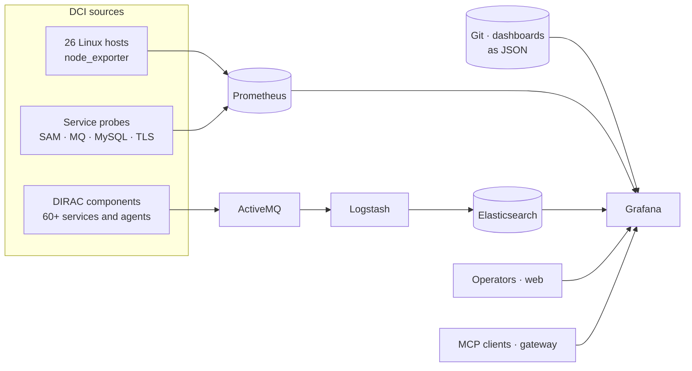
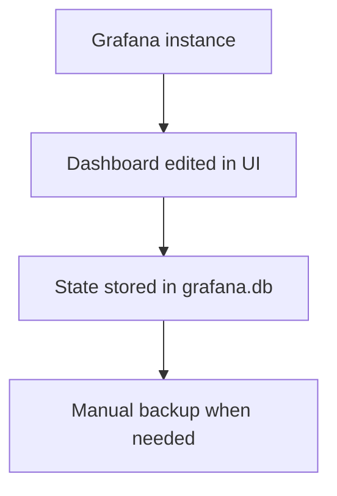
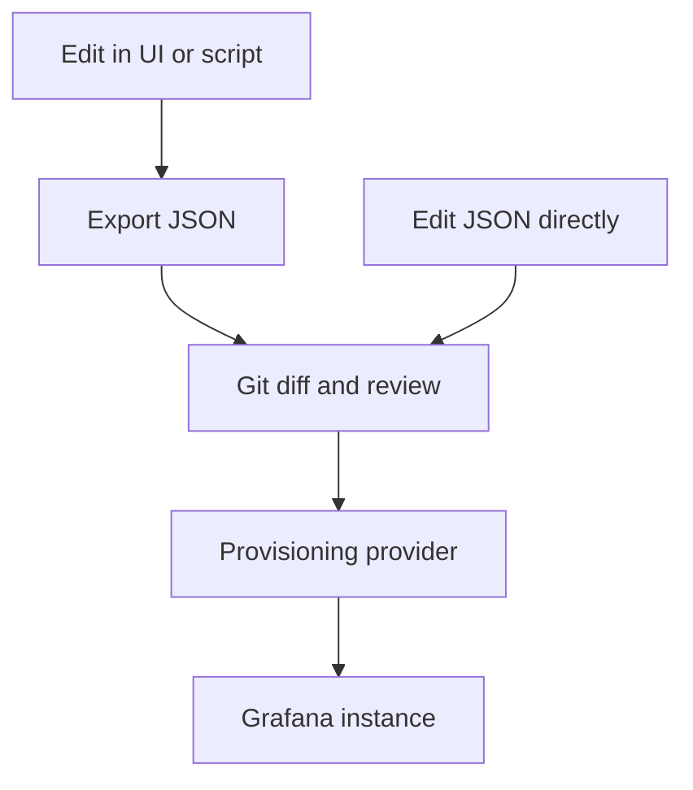
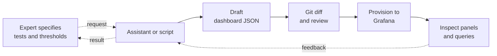
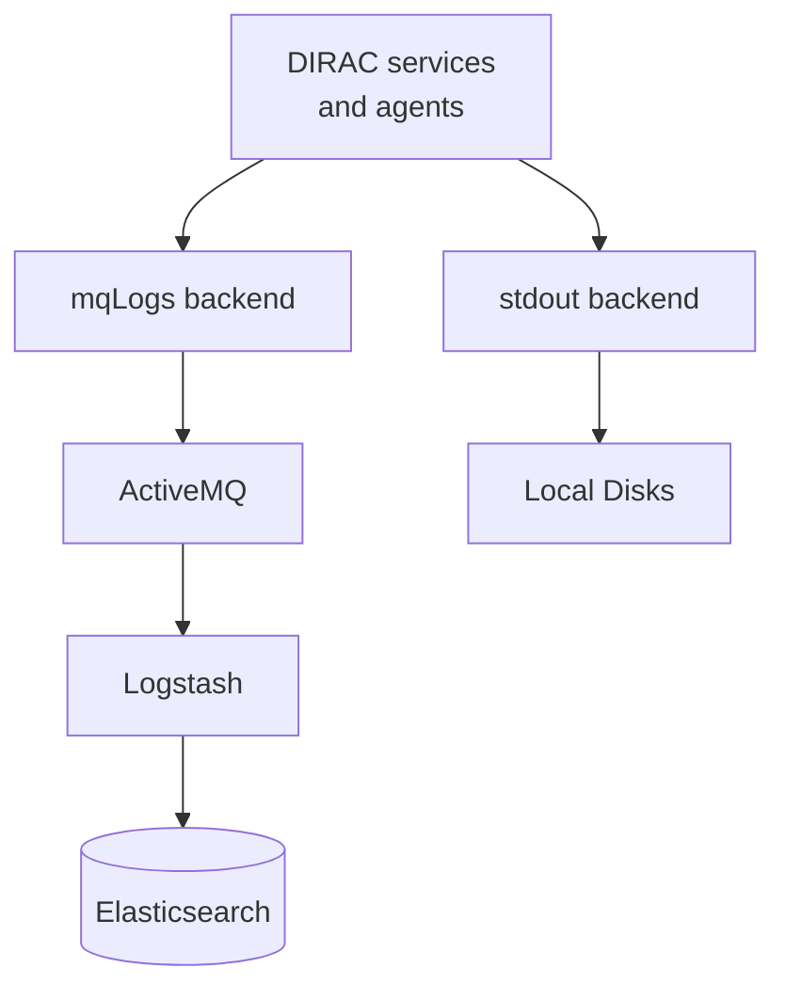

# Monitoring for the<br/>Distributed Computing Infrastructure

#### Monitoring of sites, services, and DIRAC components

<br>

**Xiao Han** on behalf of the IHEP DCI Group · <a href="mailto:hanx@ihep.ac.cn">hanx@ihep.ac.cn</a>

<br>

<a href="https://indico.ihep.ac.cn/event/28911/" class="text-sm">The 2026 International Workshop on the High Energy Circular Electron Positron Collider</a>

<br>

**24 October 2026** · *Shanghai, China*

<a href="https://dci-grafana.ihep.ac.cn/"><mdi-view-dashboard-outline /> DCI Grafana</a>
 · <a href="https://github.com/hanx-hep/28th-junocm-dci"><mdi-history /> JUNO case study</a>


<!--
Timing: 0:30

Good afternoon. I am Xiao Han, speaking on behalf of the IHEP DCI Group. This report describes the monitoring components currently used in the JUNO distributed computing environment and discusses which parts may be applicable to future CEPC computing. I will cover dashboard management, SAM service tests, DIRAC component logs, and host and service monitoring.
-->
---
layout: default
---

# Scope and reference deployment

The examples in this report come from the **JUNO distributed computing environment**.
They provide a reference for discussing future CEPC monitoring requirements.

<div class="takeaway mt-3">
<strong>Scope:</strong> existing monitoring components and the additional work needed for a new experiment.
</div>

<div class="three-cards mt-4">
  <div class="story-card">
    <mdi-source-branch class="story-icon" />
    <h2>Dashboards</h2>
    <p>Selected Grafana dashboards are stored as JSON files and loaded through file provisioning.</p>
  </div>
  <div class="story-card">
    <mdi-layers-search class="story-icon" />
    <h2>Data sources</h2>
    <p>Service probes, host metrics, and DIRAC component logs can be inspected through Grafana.</p>
  </div>
  <div class="story-card">
    <mdi-transit-connection-variant class="story-icon" />
    <h2>CEPC requirements</h2>
    <p>Monitoring targets, service tests, access rules, and alert thresholds must be defined for CEPC.</p>
  </div>
</div>


<!--
Timing: 0:55

I will use the existing JUNO environment as the reference deployment. Some dashboards are stored as JSON and provisioned from Git. Grafana also displays measurements from service probes, host exporters, and DIRAC component logs. These technical components may be useful for CEPC, but the monitored sites, service tests, permissions, and thresholds will have to be defined for CEPC rather than copied from JUNO.
-->
---
layout: default
---

# Monitoring architecture



<div class="architecture-legend">
  <span><strong>Inputs</strong><br/>host metrics, probes, logs</span>
  <span><strong>Storage and display</strong><br/>Prometheus · Elasticsearch · Grafana</span>
  <span><strong>Access</strong><br/>Grafana web interface · MCP gateway</span>
</div>

<div class="text-center muted text-xs mt-2">JUNO reference deployment · host and component counts are historical examples.</div>


<!--
Timing: 1:05

This diagram shows the monitoring paths in the JUNO reference deployment. Prometheus receives host and service metrics. DIRAC log messages are sent through ActiveMQ and Logstash to Elasticsearch. Grafana reads from both data stores. Some dashboard definitions are provided as JSON files from Git. Operators use the Grafana interface; an MCP gateway offers another controlled interface for inspection. The specific monitoring targets and permissions for CEPC remain to be defined.
-->
---
layout: section
---

# 1 · Grafana dashboards


<!--
Timing: 0:10

First I will describe how dashboard definitions are managed in the current deployment.
-->
---
layout: default
---

# Dashboard provisioning

<div class="cols mt-2">
  <div>

## Database-only dashboards



<div class="takeaway compact mt-3">
Definitions stored only in <code>grafana.db</code> have no individual change history in this Git repository.
</div>

  </div>
  <div>

## File provisioning



<div class="takeaway compact mt-3">
Provisioned dashboards are stored as JSON files. Grafana checks the files every 30 seconds.
</div>

  </div>
</div>


<!--
Timing: 1:00

The left side shows dashboards stored only in the Grafana database. Those definitions do not have an individual change history in this Git repository. The right side shows the file-provisioned path: export or edit a dashboard JSON file, review the changes in Git, and let Grafana load the file. The provider checks the files every thirty seconds. This describes the provisioned subset of dashboards, not necessarily every dashboard visible in the instance.
-->
---
layout: default
---

# Dashboard file inventory

<div class="provider-grid mt-3">
  <div class="provider"><strong>10</strong><span>Admin</span></div>
  <div class="provider"><strong>9</strong><span>DIRAC</span></div>
  <div class="provider"><strong>6</strong><span>TPC</span></div>
  <div class="provider"><strong>4</strong><span>User</span></div>
  <div class="provider"><strong>2</strong><span>Shift</span></div>
</div>

<div class="delivery-loop mt-5">
  <div><small>EDIT</small><strong>UI or JSON</strong></div>
  <mdi-arrow-right />
  <div><small>EXPORT</small><strong>Dashboard JSON</strong></div>
  <mdi-arrow-right />
  <div><small>REVIEW</small><strong>Git diff</strong></div>
  <mdi-arrow-right />
  <div><small>LOAD</small><strong>30 s check</strong></div>
</div>

<div class="two-notes mt-5">
  <div><strong>Repository inventory</strong><br/>31 JSON files in five provisioned folders: Admin, DIRAC, TPC, User, and Shift.</div>
  <div class="warning-note"><strong>UI changes</strong><br/><code>allowUiUpdates: true</code> permits editing in Grafana; export and commit the JSON to retain those changes.</div>
</div>


<!--
Timing: 1:00

The repository currently contains thirty-one dashboard JSON files in five provisioned folders. These are the files counted on this slide; other dashboards can exist in Grafana. For a provisioned dashboard, we edit or export JSON, review the diff, and let Grafana load it. UI editing is permitted, but those edits must be exported and committed if they are to persist in the repository.
-->
---
layout: default
---

# Dashboard development tools



<div class="two-notes mt-4">
  <div><strong>Suitable for scripting</strong><br/>Repeated panels, query templates, variables, and layouts for related tests.</div>
  <div><strong>Requires expert review</strong><br/>Probe definitions, query results, units, thresholds, and the final dashboard.</div>
</div>

<div class="takeaway mt-4">
The <strong>SAM v4</strong> view and the <strong>TPC transfer matrix</strong> are examples of dashboards developed with assistance; their results still require review against the underlying data.
</div>


<!--
Timing: 1:05

Templates, scripts, or an assistant can reduce the work needed to create similar panels. The important checks remain with the responsible experts: whether a probe is defined correctly, whether a query returns the intended quantity, and whether units and thresholds have operational meaning. The SAM v4 view and TPC transfer matrix are examples where assistance was used. This slide describes development practice; it does not imply that every dashboard on the Grafana server is provisioned from this repository.
-->
---
layout: section
---

# 2 · SAM service tests


<!--
Timing: 0:10

The next example is the SAM service test dashboard in Grafana.
-->
---
layout: default
---

# SAM test results

<div class="cols mt-2">
  <div>

<div class="triage-list">
  <div><small>AVAILABILITY</small><strong>Results by site and probe</strong><span>Summary values and time trends for the selected observation window.</span></div>
  <div><small>HISTORY</small><strong>State timelines</strong><span>Changes in test results can be inspected by site, probe type, or individual test.</span></div>
  <div><small>STORAGE TRANSFERS</small><strong>Site-pair results</strong><span>WebDAV and XRootD matrices and individual probe records support follow-up checks.</span></div>
</div>

  </div>
  <div>

<div class="dashboard-frame component-dashboard-frame">
  <iframe
    src="https://dci-grafana.ihep.ac.cn/d/samtestv3/sam-test-v4?orgId=1&from=1788912000000&to=1788998400000&timezone=browser&var-site=$__all&var-exclude_tests=$__all&kiosk"
    scrolling="yes"
    class="component-dashboard-iframe"
  ></iframe>
</div>

<div class="text-center mt-2">
  <a href="https://dci-grafana.ihep.ac.cn/d/samtestv3/sam-test-v4?orgId=1&from=1788912000000&to=1788998400000&timezone=browser&var-site=$__all" target="_blank" rel="noopener noreferrer"><mdi-open-in-new /> Open full dashboard · sign in if needed</a>
  <div class="embed-hint">If the embed asks for login, use the link above.</div>
</div>

  </div>
</div>


<!--
Timing: 1:15

SAM tests exercise compute and storage services from the point of view of a client. This Grafana dashboard presents results by site and probe type, time histories, storage site-pair matrices, and individual records. The iframe queries a fixed September 2026 window for the purpose of this presentation; it is not a measurement of current availability. It may load slowly.

[Demo: wait for the dashboard, then show the overview row and one mesh panel. If Grafana requires login, open the full dashboard in a new tab and sign in. Reload the slide once; if the cross-site iframe still cannot use the session, present from the full Grafana tab. Do not assume a successful iframe load means authenticated data are available.]

The upper panels summarize the selected time window. The timelines show when a test result changed. WebDAV and XRootD matrices organize results by source and destination site, while the record table contains the underlying probe results. A displayed percentage is meaningful only together with its time window and probe definition.
-->
---
layout: section
---

# 3 · DIRAC component logs


<!--
Timing: 0:10

I will now show how DIRAC component logs are collected and what remains to be done.
-->
---
layout: default
---

# DIRAC log collection

<div class="cols mt-2">
  <div>

## Component configuration

In the JUNO DIRAC setup, **60+ components** on 5 servers produce logs. The central backend is enabled alongside local output.

```text
# /opt/dirac/etc/CAS_Prod.cfg
Logging
{
  DefaultServicesBackends = stdout
  DefaultServicesBackends += mqLogs
  DefaultAgentsBackends = stdout
  DefaultAgentsBackends += mqLogs
}
```

<div class="takeaway compact mt-2">
The configuration enables <code>mqLogs</code> for services and agents while retaining <code>stdout</code>.
</div>

  </div>
  <div>

## Log transport



<div class="takeaway compact mt-2">
ActiveMQ transports log messages; Logstash processes them; Elasticsearch stores them for queries in Grafana.
</div>

  </div>
</div>


<!--
Timing: 1:00

The JUNO DIRAC setup runs more than sixty services and agents across five servers. In the configuration shown here, both services and agents retain stdout and additionally use the mqLogs backend. ActiveMQ receives the messages, Logstash processes them, and Elasticsearch stores them. Grafana queries this store. Whether the same configuration is suitable for a future CEPC DIRAC deployment will need to be checked against its component versions and operations model.
-->
---
layout: default
---

# Inspecting component logs

<div class="cols mt-2">
  <div>

<div class="triage-list">
  <div><small>LOG LEVEL</small><strong>Message counts</strong><span>Compare the number of messages by severity level.</span></div>
  <div><small>TIME</small><strong>Change in rate</strong><span>Select a period to examine a change in message frequency.</span></div>
  <div><small>COMPONENT</small><strong>Individual messages</strong><span>Filter by category and name to inspect relevant records.</span></div>
</div>

  </div>
  <div>

<div class="dashboard-frame component-dashboard-frame">
  <iframe
    src="https://dci-grafana.ihep.ac.cn/d/bfgu666p30xdsb/component-logs?orgId=1&from=now-70d&to=now-69d&timezone=browser&var-Category=$__all&var-Name=$__all&var-Level=$__all&kiosk"
    scrolling="yes"
    class="component-dashboard-iframe"
  ></iframe>
</div>

<div class="text-center mt-2">
  <a href="https://dci-grafana.ihep.ac.cn/d/bfgu666p30xdsb/component-logs?orgId=1&from=now-70d&to=now-69d&timezone=browser&var-Category=$__all&var-Name=$__all&var-Level=$__all" target="_blank" rel="noopener noreferrer"><mdi-open-in-new /> Open full dashboard · sign in if needed</a>
  <div class="embed-hint">If the embed asks for login, use the link above.</div>
</div>

  </div>
</div>


<!--
Timing: 1:10

This is the Component Logs dashboard on the live instance; its relative URL requests a one-day window 69–70 days before the presentation, so data may vary by date.

[Demo: wait for the dashboard, then scroll through the three panels. If Grafana requires login, open the full dashboard in a new tab and sign in. Reload the slide once; if the cross-site iframe still cannot use the session, present from the full Grafana tab.]

This dashboard offers three views of the same log data: counts by level, changes over time, and individual records. Filters for category, component name, and level help narrow the query. The time window in this example is relative and may need adjustment during the presentation. The next slide lists proposed improvements; they are not part of the current log collection pipeline.
-->
---
layout: default
---

# Planned log-monitoring work

<div class="two-notes mt-4">
  <div><strong>Available</strong><br/>Central collection and a dashboard for filtering and inspecting component records.</div>
  <div><strong>Not yet evaluated</strong><br/>Alert criteria, log retention periods, and links from service metrics to log records.</div>
</div>

<div class="status-stack next cols-2 mt-3">
  <div><mdi-arrow-right-circle-outline /><span><strong>Repeated error messages</strong><br/>Evaluate grouping by component and message type.</span></div>
  <div><mdi-arrow-right-circle-outline /><span><strong>Rate-based alerts</strong><br/>Establish baselines before setting component-specific thresholds.</span></div>
  <div><mdi-arrow-right-circle-outline /><span><strong>Retention policy</strong><br/>Define storage periods and index lifecycle requirements.</span></div>
  <div><mdi-arrow-right-circle-outline /><span><strong>Metrics and logs</strong><br/>Preserve component and time selections when moving between views.</span></div>
</div>

<div class="takeaway mt-4">
Check log delivery and field mappings when changing <strong>DIRAC versions</strong> or component configurations.
</div>


<!--
Timing: 1:10

The current pipeline collects and stores logs and supports manual searches. Further work is needed before it can reliably drive alerts. We need to examine repeated messages, define baselines and thresholds by component, agree on retention periods, and preserve context when switching from a metric to log records. When DIRAC is upgraded or reconfigured, the log backend and parsed fields should be tested again. These are proposed tasks, not delivered functions.
-->
---
layout: section
---

# 4 · Hosts and services


<!--
Timing: 0:10

The final example concerns machine-level measurements and service checks.
-->
---
layout: default
---

# Host and service monitoring

<div class="cols mt-10">
  <div>

## Prometheus targets

```bash
# on the monitoring server
prometheus-cmd.py add  <hostname> 9100
prometheus-cmd.py list
prometheus-cmd.py remove <hostname>
```

<div class="takeaway compact mt-5">
The target-management command updates the Prometheus configuration on the monitoring server.
</div>

  </div>
  <div>

## Reference deployment

<div class="provider-grid two-wide mt-4">
  <div class="provider"><strong>26</strong><span>hosts*</span></div>
  <div class="provider"><strong>10</strong><span>jobs*</span></div>
</div>

<div class="filter-strip mt-4">
  <span>machinery</span><span>activemq</span><span>mysql</span><span>eos</span><span>oidc</span><span>tls</span>
</div>

<div class="takeaway compact mt-5">
Host metrics include CPU, memory, disk, and network use. Other jobs check services and certificate expiry. <small>*Monitoring snapshot, September 2026.</small>
</div>

  </div>
</div>


<!--
Timing: 1:00

The host metrics are collected by Prometheus from node exporters. The twenty-six hosts and ten job names shown here are a snapshot from September 2026, not a measurement of the current fleet. Jobs include machine metrics and checks for services such as ActiveMQ, MySQL, storage, authentication, and certificate expiry. The command-line tool on the monitoring server manages targets; it is not intended to run from this slide repository. CEPC would require its own target inventory and service coverage.
-->
---
layout: default
---

# Status and remaining work

<div class="cols mt-2">
  <div>

## Available in the reference setup

<div class="status-stack tight">
  <div><mdi-check-circle-outline /><span><strong>Dashboard files</strong><br/>31 JSON files in five provisioned folders</span></div>
  <div><mdi-check-circle-outline /><span><strong>SAM test view</strong><br/>Results by site, probe, and storage site pair</span></div>
  <div><mdi-check-circle-outline /><span><strong>DIRAC log collection</strong><br/>Central storage and inspection in Grafana</span></div>
  <div><mdi-check-circle-outline /><span><strong>Host metrics</strong><br/>Prometheus exporters and service checks</span></div>
</div>

  </div>
  <div>

## To define or validate

<div class="status-stack next tight">
  <div><mdi-arrow-right-circle-outline /><span><strong>Alert criteria</strong><br/>Thresholds, recipients, and response procedures</span></div>
  <div><mdi-arrow-right-circle-outline /><span><strong>Service tests</strong><br/>CEPC sites, probe definitions, and test coverage</span></div>
  <div><mdi-arrow-right-circle-outline /><span><strong>Log monitoring</strong><br/>Baselines, retention, and DIRAC compatibility</span></div>
  <div><mdi-arrow-right-circle-outline /><span><strong>CEPC configuration</strong><br/>Target inventory, dashboards, and access rules</span></div>
</div>

  </div>
</div>


<!--
Timing: 1:00

The left column summarizes functions demonstrated in the JUNO reference environment. The thirty-one dashboard files are counted from the provisioning repository; the SAM dashboard is a separate example from the Grafana instance. The host and job counts on the previous slide were measured in September, so they should not be read as current capacity. The right column lists work that requires CEPC-specific definitions and validation, including tests, access rules, thresholds, and operational responsibilities.
-->
---
layout: default
---

# Summary

<div class="three-cards takeaway-cards mt-6">
  <div class="story-card"><strong>1</strong><h2>Available tools</h2><p>Grafana displays host measurements, SAM results, and DIRAC logs from the reference setup.</p></div>
  <div class="story-card"><strong>2</strong><h2>Configuration</h2><p>Provisioned dashboard definitions are maintained as JSON files in Git.</p></div>
  <div class="story-card"><strong>3</strong><h2>CEPC work</h2><p>Site targets, probes, alert criteria, and permissions must be specified and tested.</p></div>
</div>

<div class="closing-line mt-10">
The JUNO deployment provides a technical reference.<br/>
CEPC monitoring requires its own <strong>requirements and validation</strong>.
</div>


<!--
Timing: 0:50

To summarize: Grafana can display the host, service-test, and DIRAC log information already collected in the JUNO reference environment. File provisioning makes the selected dashboard definitions easier to maintain and review. Before using this approach for CEPC, we must identify its sites and services, choose probes and thresholds, define access, and validate the monitoring chain against actual CEPC operations. This is an example architecture, not a claim that CEPC monitoring is already complete.
-->
---
layout: cover
loop: true
title: Questions
---


# Questions

**Xiao Han · IHEP, CC**<br/>
DCI Group

<a href="https://dci-grafana.ihep.ac.cn/"><mdi-view-dashboard-outline /> dci-grafana.ihep.ac.cn</a>
 · <a href="https://github.com/hanx-hep/28th-junocm-dci"><mdi-github /> JUNO case study</a>

<!--
Timing: 0:15

That is the end of my report. Thank you, and I am happy to take questions.
-->
