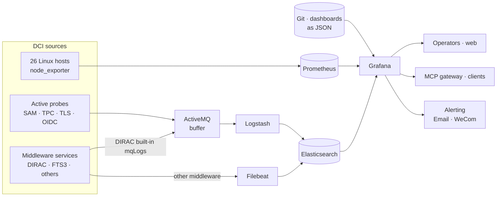
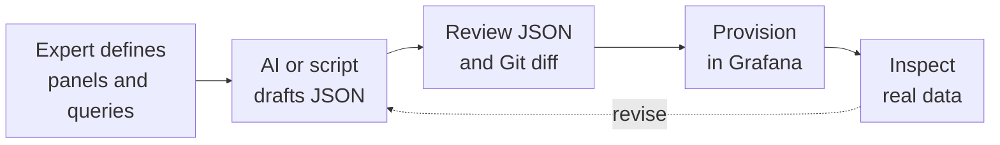
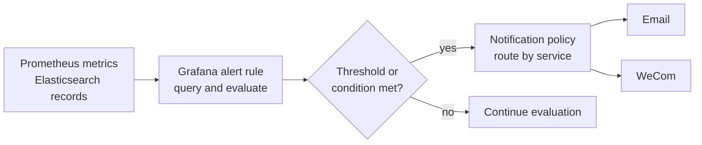
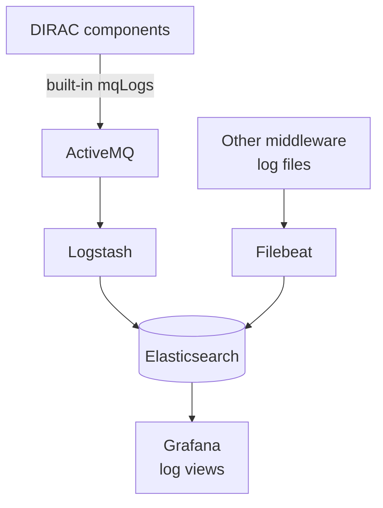
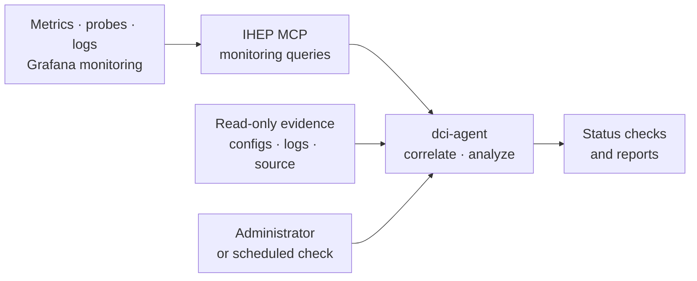

<a href="https://english.ihep.cas.cn/" class="cover-ihep-logo" target="_blank" rel="noopener noreferrer" aria-label="Institute of High Energy Physics website"></a>

# Monitoring for the<br/>Distributed Computing Infrastructure

#### Monitoring of sites, services, and middleware

<br>

**Xiao Han** on behalf of the IHEP DCI Group · <a href="mailto:hanx@ihep.ac.cn">hanx@ihep.ac.cn</a>

<br>

<a href="https://indico.ihep.ac.cn/event/28911/" class="text-sm">The 2026 International Workshop on the High Energy Circular Electron Positron Collider</a>

<br>

**24 October 2026** · *Shanghai, China*

<a href="https://dci-grafana.ihep.ac.cn/"><mdi-view-dashboard-outline /> DCI Grafana</a>
 · <a href="https://github.com/hanx-hep/28th-junocm-dci"><mdi-history /> JUNO case study</a>


<!--
Timing: 0:30

Good afternoon. I am Xiao Han, speaking on behalf of the IHEP DCI Group. This report describes the IHEP monitoring system used for JUNO, HERD, and shared distributed-computing infrastructure, and discusses which parts may be applicable to future CEPC computing. I will cover Grafana access and dashboards, active service probes, centralized middleware logs, host metrics, and how dci-agent helps operators inspect this evidence.
-->
---
layout: default
---

# Motivation and current use

<div class="cols mt-8">
  <div class="scope-panel">
    <h2>Why monitoring matters</h2>
    <p>Modern large-scale high-energy physics experiments rely on distributed computing for data transfer, storage, and processing across sites.</p>
    <p>CEPC will also require DCI. Monitoring is needed to assess the availability and performance of computing sites, services, and data-transfer paths.</p>
  </div>
  <div class="scope-panel">
    <h2>IHEP DCI monitoring today</h2>
    <p>The IHEP DCI monitoring system already supports <strong>JUNO</strong> and <strong>HERD</strong>.</p>
    <p>It also covers shared distributed-computing infrastructure, including hosts, middleware services, and service probes.</p>
    <div class="experiment-logos">
      <a href="https://juno.ihep.cas.cn/" target="_blank" rel="noopener noreferrer" aria-label="JUNO experiment website">
        
      </a>
      <a href="https://herd.ihep.ac.cn/" target="_blank" rel="noopener noreferrer" aria-label="HERD experiment website">
        
      </a>
    </div>
    <div class="logo-credit">Images: <a href="https://english.ihep.cas.cn/nw/han/y15/201501/t20150123_296525.html" target="_blank" rel="noopener noreferrer">JUNO Collaboration</a> · <a href="https://herd-iam.ihep.ac.cn/resources/images/logos/herd-logo.png" target="_blank" rel="noopener noreferrer">HERD IAM</a></div>
  </div>
</div>


<!--
Timing: 0:55

Distributed computing infrastructure is part of how modern large-scale high-energy physics experiments move, store, and process data at multiple sites. CEPC will need this infrastructure, so monitoring the state of its sites, services, and data-transfer paths will matter. At IHEP, the current monitoring system supports JUNO and HERD and also covers shared computing infrastructure. The following technical examples come largely from the existing deployment; CEPC-specific sites, tests, access rules, and alert thresholds still need to be specified.
-->
---
layout: default
---

# Monitoring architecture



<div class="architecture-note mt-4">
The existing IHEP DCI monitoring system supports JUNO and HERD and also monitors shared distributed-computing infrastructure.
</div>

<div class="text-center muted text-xs mt-2">Architecture shown schematically; the host count is a historical example.</div>


<!--
Timing: 1:05

This schematic describes the existing IHEP DCI monitoring system, which supports JUNO and HERD as well as shared computing infrastructure. Host metrics go to Prometheus. Active probe results, including SAM, TPC, certificate, and OIDC checks, can pass through ActiveMQ and Logstash to Elasticsearch. DIRAC's built-in mqLogs backend also sends records through ActiveMQ and Logstash before Elasticsearch. Other middleware, such as FTS3, may use Filebeat to ship local log files. Grafana displays data to web operators and MCP clients and sends email and WeCom alerts. CEPC-specific alert rules and recipient lists would need to be defined separately.
-->
---
layout: section
---

# 1 · Grafana dashboards


<!--
Timing: 0:10

First I will describe the Grafana system, how dashboard definitions are managed, and how alerting works.
-->
---
layout: default
---

# Grafana monitoring system

<div class="grafana-intro mt-3">
  <div class="grafana-features">
    <div class="feature-item">
      <strong>Multiple organizations</strong>
      <ul>
        <li>JUNO monitoring</li>
        <li>HERD monitoring</li>
        <li>Grid middleware, including CA services</li>
      </ul>
    </div>
    <div class="feature-item"><strong>IHEP account login</strong><span>Users access Grafana with their IHEP identity.</span></div>
    <div class="feature-item"><strong>Access control</strong><span>Organization and dashboard permissions limit who can view or edit.</span></div>
    <div class="feature-item"><strong>Alerts</strong><span>Rules on monitored data can notify operators by email and WeCom.</span></div>
  </div>
  <div class="grafana-demo">
    <video :src="'./grafana-demo-trimmed.mp4'" autoplay loop muted playsinline controls preload="metadata" aria-label="Grafana interface screen recording"></video>
    <div class="grafana-demo-caption"><mdi-monitor-screenshot /> Grafana interface · 1.5× · no audio</div>
  </div>
</div>


<!--
Timing: 1:00

Grafana is the common web interface for IHEP DCI monitoring. We use multiple organizations for JUNO, HERD, and grid middleware such as CA services. IHEP account login and permissions control access to dashboards and configuration. Grafana also evaluates alert rules and sends notifications through email and WeCom. The recording on the right shows the interface at 1.5 times the original speed, without audio. It has been trimmed by five seconds at the start and ten seconds at the readable end.
-->
---
layout: default
---

# Dashboard JSON workflow



<div class="json-details mt-6">
  <div><strong>31 JSON files in Git</strong><br/>Admin 10 · DIRAC 9 · TPC 6 · User 4 · Shift 2</div>
  <div><strong>30-second file check</strong><br/>Grafana loads the files; unexported UI edits to provisioned dashboards can be overwritten.</div>
  <div><strong>Human validation</strong><br/>AI helps with repeated panels. Experts check queries, units, thresholds, and results.</div>
</div>

<div class="takeaway compact mt-5">The <strong>SAM v4</strong> and <strong>TPC transfer matrix</strong> views illustrate assisted development. File provisioning covers the repository’s dashboards, not every dashboard in the instance.</div>


<!--
Timing: 1:25

Dashboard definitions can be exported from the Grafana UI or drafted as JSON with scripts and AI assistance. Experts check queries, units, thresholds, and panels against actual data before committing. The repository currently has thirty-one JSON files in five folders; Grafana checks provisioned files every thirty seconds. UI edits must be exported and committed to persist for a provisioned dashboard. SAM v4 and the TPC transfer matrix are examples of assisted development. This inventory does not include dashboards stored only in the instance database.
-->
---
layout: default
---

# Grafana alerting



<div class="two-notes compact-notes mt-3">
  <div><strong>Rule</strong><br/>Select a monitored quantity, evaluation interval, and condition relevant to the service.</div>
  <div><strong>Response</strong><br/>Route the notification to its operators; the alert is a signal for investigation, not a diagnosis.</div>
</div>

<div class="takeaway compact mt-3">Existing delivery channels: <strong>email and WeCom</strong>. CEPC-specific thresholds, recipients, and response procedures still need to be defined.</div>

<!--
Timing: 0:55

Grafana evaluates a query against a rule at regular intervals. When the specified condition holds, the notification policy routes the alert to the responsible operators, here by email or WeCom. The diagram shows the general mechanism rather than a particular production rule. For a new experiment, the monitored quantities, thresholds, recipients, and operational response must be agreed and tested separately.
-->
---
layout: section
---

# 2 · Active probing


<!--
Timing: 0:10

Active probes test services from the outside. The next two slides cover the range of checks and the SAM site-to-site matrix.
-->
---
layout: default
---

# Active service checks

<div class="probe-grid mt-6">
  <div><strong>SAM site tests</strong><span>Service and storage checks from a client or another grid site; results form a source–destination matrix.</span></div>
  <div><strong>TPC tests</strong><span>Third-party copy checks exercise transfer paths between storage endpoints.</span></div>
  <div><strong>Certificate checks</strong><span>Check TLS validity and remaining lifetime before expiry affects a service.</span></div>
  <div><strong>OIDC checks</strong><span>Test the identity-service endpoints needed for authentication.</span></div>
</div>

<div class="takeaway mt-6">Active probing measures whether a service or transfer path works <strong>from a client’s point of view</strong>; host metrics alone cannot establish that.</div>

<!--
Timing: 0:55

Active probing is broader than SAM. We run checks for site services and inter-site transfers, including TPC. Certificate checks cover TLS expiry, and OIDC checks cover identity endpoints. These tests complement host metrics because a healthy server does not necessarily mean a remote client can authenticate, reach a service, or transfer data. The SAM matrix on the next slide is one detailed example of this approach.
-->
---
layout: default
---

# SAM site-to-site matrix

<div class="cols mt-2">
  <div>

<div class="triage-list">
  <div><small>SOURCE × DESTINATION</small><strong>Every site pair matters</strong><span>Tests run from each grid site to the other sites, not only against one central endpoint.</span></div>
  <div><small>TRANSFER PROTOCOLS</small><strong>WebDAV and XRootD</strong><span>Success-rate matrices expose paths that fail in one direction or between particular sites.</span></div>
  <div><small>FOLLOW-UP</small><strong>Timelines and records</strong><span>Inspect when failures started and which underlying probes produced them.</span></div>
</div>

  </div>
  <div>

<div class="dashboard-frame component-dashboard-frame">
  <iframe
    src="https://dci-grafana.ihep.ac.cn/d/samtestv3/sam-test-v4?orgId=1&from=1788912000000&to=1788998400000&timezone=browser&var-site=$__all&var-exclude_tests=$__all&kiosk"
    scrolling="yes"
    class="component-dashboard-iframe"
  ></iframe>
</div>

<div class="text-center mt-2">
  <a href="https://dci-grafana.ihep.ac.cn/d/samtestv3/sam-test-v4?orgId=1&from=1788912000000&to=1788998400000&timezone=browser&var-site=$__all" target="_blank" rel="noopener noreferrer"><mdi-open-in-new /> Open full dashboard · sign in if needed</a>
  <div class="embed-hint">If the embed asks for login, use the link above.</div>
</div>

  </div>
</div>


<!--
Timing: 1:15

SAM is a prominent part of active probing because distributed storage is not described adequately by a single availability value per site. Network paths, routes, and site configurations differ: a site may reach one partner but not another, and the reverse direction may behave differently. We therefore examine a source-by-destination site matrix. The iframe queries a fixed September 2026 window for this presentation; it is not a measurement of current availability. It may load slowly.

[Demo: wait for the dashboard, then show the overview row and one mesh panel. If Grafana requires login, open the full dashboard in a new tab and sign in. Reload the slide once; if the cross-site iframe still cannot use the session, present from the full Grafana tab. Do not assume a successful iframe load means authenticated data are available.]

The upper panels summarize the selected time window. The WebDAV and XRootD matrices are the central point: each cell represents a particular source and destination, so we can distinguish a site-wide failure from a path-specific or asymmetric problem. Timelines and raw probe records help confirm when and how a particular pair failed. Percentages must always be read together with the selected window and probe definition.
-->
---
layout: section
---

# 3 · Middleware logs


<!--
Timing: 0:10

This section describes centralized log storage for grid middleware, with DIRAC and Filebeat as two ingestion methods.
-->
---
layout: default
---

# Centralized middleware logs

<div class="cols mt-2">
  <div>

## Collection methods

<div class="triage-list mt-4">
  <div><small>DIRAC</small><strong>Built-in mqLogs backend</strong><span>DIRAC services and agents send logs through ActiveMQ and Logstash into Elasticsearch.</span></div>
  <div><small>OTHER MIDDLEWARE</small><strong>Filebeat when needed</strong><span>A log shipper can read local log files from components such as FTS3 and forward them for central indexing.</span></div>
</div>

<div class="takeaway compact mt-3">Common fields such as time, component, and severity support cross-service searches.</div>

  </div>
  <div>

## Storage and inspection



  </div>
</div>


<!--
Timing: 1:00

The JUNO DIRAC setup includes more than sixty services and agents across five servers. DIRAC's built-in mqLogs backend sends records to ActiveMQ, which buffers them before Logstash processes them into Elasticsearch. For other middleware, a shipper such as Filebeat can collect local log files instead; this is an available collection pattern, not a claim that all components already use Filebeat. Elasticsearch is the shared store, and Grafana provides the inspection interface. Field mappings and delivery should be validated per component and again when a middleware version changes.
-->
---
layout: default
---

# Inspecting component logs

<div class="cols mt-2">
  <div>

<div class="triage-list">
  <div><small>LOG LEVEL</small><strong>Message counts</strong><span>Compare the number of messages by severity level.</span></div>
  <div><small>TIME</small><strong>Change in rate</strong><span>Select a period to examine a change in message frequency.</span></div>
  <div><small>COMPONENT</small><strong>Individual messages</strong><span>Filter by category and name to inspect relevant records.</span></div>
</div>

  </div>
  <div>

<div class="dashboard-frame component-dashboard-frame">
  <iframe
    src="https://dci-grafana.ihep.ac.cn/d/bfgu666p30xdsb/component-logs?orgId=1&from=now-70d&to=now-69d&timezone=browser&var-Category=$__all&var-Name=$__all&var-Level=$__all&kiosk"
    scrolling="yes"
    class="component-dashboard-iframe"
  ></iframe>
</div>

<div class="text-center mt-2">
  <a href="https://dci-grafana.ihep.ac.cn/d/bfgu666p30xdsb/component-logs?orgId=1&from=now-70d&to=now-69d&timezone=browser&var-Category=$__all&var-Name=$__all&var-Level=$__all" target="_blank" rel="noopener noreferrer"><mdi-open-in-new /> Open full dashboard · sign in if needed</a>
  <div class="embed-hint">If the embed asks for login, use the link above.</div>
</div>

  </div>
</div>


<!--
Timing: 1:10

This is the DIRAC Component Logs dashboard on the live instance, as an example of centralized middleware log inspection. Its relative URL requests a one-day window 69–70 days before the presentation, so data may vary by date.

[Demo: wait for the dashboard, then scroll through the three panels. If Grafana requires login, open the full dashboard in a new tab and sign in. Reload the slide once; if the cross-site iframe still cannot use the session, present from the full Grafana tab.]

This dashboard offers three views of DIRAC log data: counts by level, changes over time, and individual records. Filters for category, component name, and level help narrow the query. The time window in this example is relative and may need adjustment during the presentation. The next slide lists proposed improvements across middleware services; they are not part of the current log collection pipeline.
-->
---
layout: default
---

# Planned log-monitoring work

<div class="two-notes mt-4">
  <div><strong>Available</strong><br/>Central collection and a dashboard for filtering and inspecting component records.</div>
  <div><strong>Not yet evaluated</strong><br/>Alert criteria, log retention periods, and links from service metrics to log records.</div>
</div>

<div class="status-stack next cols-2 mt-3">
  <div><mdi-arrow-right-circle-outline /><span><strong>Repeated error messages</strong><br/>Evaluate grouping by component and message type.</span></div>
  <div><mdi-arrow-right-circle-outline /><span><strong>Rate-based alerts</strong><br/>Establish baselines before setting component-specific thresholds.</span></div>
  <div><mdi-arrow-right-circle-outline /><span><strong>Retention policy</strong><br/>Define storage periods and index lifecycle requirements.</span></div>
  <div><mdi-arrow-right-circle-outline /><span><strong>Metrics and logs</strong><br/>Preserve component and time selections when moving between views.</span></div>
</div>

<div class="takeaway mt-4">Check log delivery and field mappings when changing <strong>middleware versions</strong> or collection methods.</div>


<!--
Timing: 1:10

The current pipeline collects and stores logs and supports manual searches. Further work is needed before it can reliably drive alerts. We need to examine repeated messages, define baselines and thresholds by component, agree on retention periods, and preserve context when switching from a metric to log records. When middleware is upgraded or reconfigured, the chosen collector and parsed fields should be tested again. These are proposed tasks, not delivered functions.
-->
---
layout: section
---

# 4 · Hosts and services


<!--
Timing: 0:10

The last monitoring source is machine-level measurements and service checks; then I will briefly show how dci-agent uses the evidence.
-->
---
layout: default
---

# Host and service monitoring

<div class="cols mt-10">
  <div>

## Prometheus targets

```bash
# on the monitoring server
prometheus-cmd.py add  <hostname> 9100
prometheus-cmd.py list
prometheus-cmd.py remove <hostname>
```

<div class="takeaway compact mt-5">
The target-management command updates the Prometheus configuration on the monitoring server.
</div>

  </div>
  <div>

## Reference deployment

<div class="provider-grid two-wide mt-4">
  <div class="provider"><strong>26</strong><span>hosts*</span></div>
  <div class="provider"><strong>10</strong><span>jobs*</span></div>
</div>

<div class="filter-strip mt-4">
  <span>machinery</span><span>activemq</span><span>mysql</span><span>eos</span><span>oidc</span><span>tls</span>
</div>

<div class="takeaway compact mt-5">
Host metrics include CPU, memory, disk, and network use. Other jobs check services and certificate expiry. <small>*Monitoring snapshot, September 2026.</small>
</div>

  </div>
</div>


<!--
Timing: 1:00

The host metrics are collected by Prometheus from node exporters. The twenty-six hosts and ten job names shown here are a snapshot from September 2026, not a measurement of the current fleet. Jobs include machine metrics and checks for services such as ActiveMQ, MySQL, storage, authentication, and certificate expiry. The command-line tool on the monitoring server manages targets; it is not intended to run from this slide repository. CEPC would require its own target inventory and service coverage.
-->
---
layout: default
---

# dci-agent and monitoring evidence



<div class="two-notes mt-4">
  <div><strong>Across systems</strong><br/>Combine monitoring results with read-only evidence from DIRAC and related middleware to investigate a fault.</div>
  <div><strong>Action boundary</strong><br/>Operational writes use separate, scoped MCP functions. Critical changes remain subject to administrator control.</div>
</div>

<!--
Timing: 1:00

Monitoring data are useful when they can be related to configurations, logs, and the middleware chain. The Hermes-based dci-agent uses IHEP MCP monitoring queries together with sanitized read-only evidence from systems such as DIRAC and FTS3. Administrators or scheduled checks can ask for cross-system status and reports. The read-only evidence path does not grant write access. If an operational action is permitted, it uses a separate, scoped MCP function; critical changes require administrator control. This is an operations assistant, not an automatic fault-repair system. The architecture and boundaries are described in the 12th DIRACx Workshop report.
-->
---
layout: default
---

# Status and CEPC work

<div class="cols mt-2">
  <div>

## Operating at IHEP

<div class="status-stack tight">
  <div><mdi-check-circle-outline /><span><strong>Grafana</strong><br/>Multi-org dashboards, 31 provisioned JSON files, email and WeCom alerts</span></div>
  <div><mdi-check-circle-outline /><span><strong>Active probing</strong><br/>SAM site-pair matrix, TPC, certificate, and OIDC checks</span></div>
  <div><mdi-check-circle-outline /><span><strong>Metrics and logs</strong><br/>Host and service metrics; centralized DIRAC component records</span></div>
  <div><mdi-check-circle-outline /><span><strong>dci-agent</strong><br/>Cross-system checks and reports with scoped action boundaries</span></div>
</div>

  </div>
  <div>

## Needed for CEPC

<div class="status-stack next tight">
  <div><mdi-arrow-right-circle-outline /><span><strong>Site and service inventory</strong><br/>List endpoints, owners, and dashboard access</span></div>
  <div><mdi-arrow-right-circle-outline /><span><strong>Probe coverage</strong><br/>Define CEPC site pairs, transfer protocols, and test cadence</span></div>
  <div><mdi-arrow-right-circle-outline /><span><strong>Operational alerts</strong><br/>Set thresholds, recipients, and response procedures</span></div>
  <div><mdi-arrow-right-circle-outline /><span><strong>Log policy</strong><br/>Check middleware ingestion, retention, and field mappings</span></div>
</div>

  </div>
</div>


<!--
Timing: 1:00

The left side is what is already in use at IHEP: Grafana for JUNO, HERD, and shared infrastructure; active tests, host metrics, centralized DIRAC logs, and dci-agent for cross-system investigation. The 31 files are the repository inventory, not all dashboards in the instance. Filebeat remains an optional pattern for other middleware. The right side is not a generic promise of reuse: CEPC must identify sites and service owners, decide which site pairs and transfer protocols to probe, set alert recipients and procedures, and validate log ingestion and retention. The historical host counts should not be read as current fleet size.
-->
---
layout: default
---

# Summary

<div class="three-cards takeaway-cards mt-6">
  <div class="story-card"><strong>1</strong><h2>Measure paths</h2><p>Host health alone is insufficient; site-pair probes reveal transfer failures and network asymmetry.</p></div>
  <div class="story-card"><strong>2</strong><h2>Relate evidence</h2><p>Metrics, probes, and middleware logs can be inspected together; dci-agent helps connect them during diagnosis.</p></div>
  <div class="story-card"><strong>3</strong><h2>Adapt to CEPC</h2><p>Reuse the monitoring methods, but specify CEPC targets, thresholds, ownership, and access before deployment.</p></div>
</div>

<div class="closing-line mt-10">
IHEP DCI provides a working reference.<br/>
CEPC monitoring needs <strong>experiment-specific tests and operational ownership</strong>.
</div>


<!--
Timing: 0:50

Three conclusions. First, monitoring has to test inter-site paths as well as individual services: a source-to-destination matrix shows failures that a per-site uptime number misses. Second, metrics, active tests, and middleware logs are more useful together, and dci-agent can assist an operator in relating that evidence without treating an alert as an automatic diagnosis. Third, CEPC can reuse the architecture and dashboard-management methods, but must establish its own tests, access rules, thresholds, and responsibilities. The IHEP deployment is a reference, not a completed CEPC deployment.
-->
---
layout: cover
loop: true
title: Questions
---


# Questions

**Xiao Han · IHEP, CC**<br/>
DCI Group

<a href="https://dci-grafana.ihep.ac.cn/"><mdi-view-dashboard-outline /> dci-grafana.ihep.ac.cn</a>
 · <a href="https://github.com/hanx-hep/28th-junocm-dci"><mdi-github /> JUNO case study</a>

<!--
Timing: 0:15

That is the end of my report. Thank you, and I am happy to take questions.
-->
